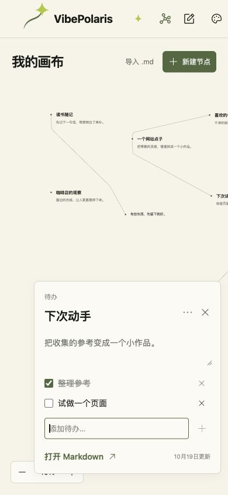
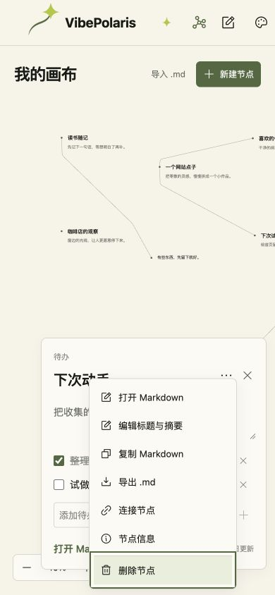

# VBP-097 自由画布节点交互

用户选择首批支持笔记、链接、图片、待办。所有节点共用拖动、连线、简述和 Markdown；不增加强制分类或日期。

空白右键按类型在点击位置创建，顶部按钮提供相同入口；双击直接创建笔记。节点右键与卡片的“…”共用菜单，支持打开 Markdown、就地编辑、复制、导出、连线、信息与删除，保留删除撤销。菜单按实际尺寸贴合视口，支持方向键、Home/End 和 Escape 返回触发按钮。

简述卡片提供直接可编辑的标题和摘要，自动保存。手动显示信息与正文分离，旧笔记仍从 Markdown 提取。链接填写完整网址或站内路径；图片允许上传 5 MB 内的常见栅格格式或填写图片地址；待办在卡片直接增删、勾选，并与标准 Markdown 任务列表互通。

## 数据约定

- 新增可选 kind/title/summary，正文仍为自由 Markdown。无新增依赖、账号或后端接口。
- 旧版本 1 画布兼容读取，保存时升级版本 2；旧程序会拒绝新数据而非丢弃未知字段。回滚旧程序期间需恢复新版后继续编辑新画布。
- 复制和导出在正文前添加 JSON HTML 注释，保留类型与手动标题摘要。普通旧笔记未设置元数据时原文直接输出。导入原子校验，错误不改已有节点；含本地图片的正文使用 data URL 随文件迁移，导入上限 10 MB。
- 图片只为 src 放行限定栅格 data URL，其他 Markdown 链接沿用默认安全转换；链接节点仅允许 http(s) 和站内路径。原始 HTML 不执行。
- 本地 IndexedDB、冲突保护与浏览器隔离延续原实现。Markdown 不携带画布位置和连线。

## 实际本地验证（2026-10-19）

- 新闻预检查、Next production build、TypeScript 和 1185 页面生成通过；6 项 canvas 小测试通过，包括旧画布升级、四种元数据往返、正文不变、安全地址、待办和连线避让。
- 真实浏览器从原有 6 节点、3 连线画布开始，保留旧内容。右键新建笔记，就地改标题摘要；在全文改成另一正文标题后，卡片手动信息仍保留。
- 链接节点填写 `/terms/css` 生成站内链接；图片上传本仓库 valley.jpg，可在卡片、画布与全文阅读显示，刷新仍可见。
- 图片复制与导出逐字一致（231495 字符）；重新导入后类型、标题、摘要和图片恢复，原节点保留。
- 待办添加两项、勾选一项、删除及重新添加第二项，刷新后仍为 1/2 完成。
- 导入图片连到链接节点，节点数 11、边数 4；右键删除后为 10、3，撤销恢复 11、4；拖动链接节点后路径更新。
- 390×844 真实浏览器宽度下卡片、菜单未越界；菜单 End 聚焦删除，Escape 关闭并返回按钮，未误删。测试后恢复正常视口。
- 发现 BUG-51276764：旧“显示全部”按 95px 高度取景导致图片裁切。改为实际标签尺寸；自动放置考虑图片高度。回归后所有节点底部均位于视口内（底部图片 688.84 < 737）。
- 浏览器 warn/error 为空。截图与浏览器事实在本目录。未做无关整站回归、真机触摸或浏览器存储耗尽注入。

## 最终浮层修正 BUG-4267D97A

连续清理临时节点时发现撤销提示（z80）遮住贴底菜单（z70）的删除项，实际点击命中提示甚至误触撤销；图片卡片也超过定位预留的固定高度。菜单提升至 z90，卡片通过 ResizeObserver 测量真实高度并留出底部 12px。

重新构建通过。真实浏览器 662×737：撤销提示仍在时，删除项中心 `elementFromPoint` 命中“删除节点”，卡片底部 725.18 < 737；连续删除使节点数 9→8→7→6，原有 6 节点、3 连线均保留。断言和截图见 `overlay-regression.json`、`overlay-regression.png`。初版已完成服务健康切换，最终发布验收以本修正完成并生产回归为准。

## 生产验收

最终 main `fa83494761a84fdeb2220248fb4d95afcac65170` 已部署生产，四种节点、Markdown 往返、刷新、删除撤销及浮层回归通过。独立测试浏览器的数据已清理至 0 节点、0 边，控制台无警告或错误；其他浏览器的数据未修改。见 [发布记录](../../development/VBP-097-canvas-production.md) 和本目录 production-browser.json。
