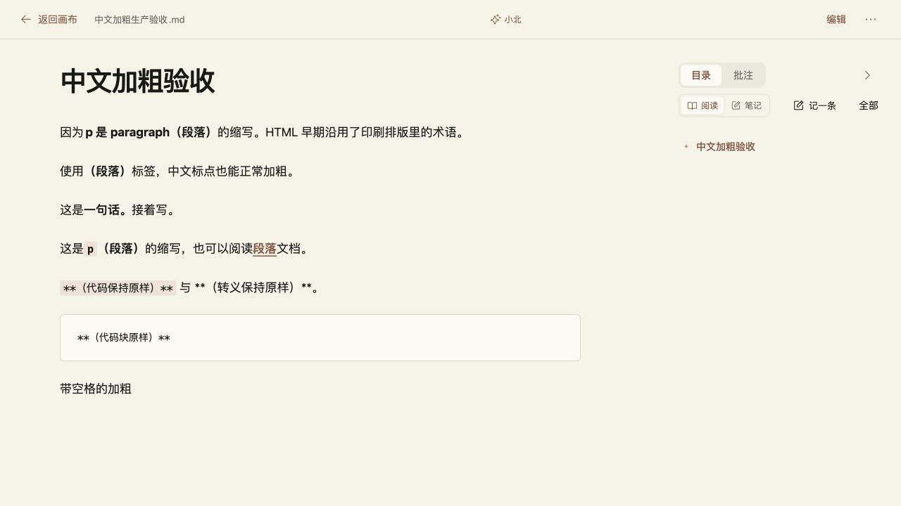

# BUG-C2F3190D 中文括号加粗

2026-10-26，关联 VBP-103。用户截图反馈 `**…**` 原样显示。开发和测试负责人顾毅盛，任务 `e2ed9e10-591f-4373-8a14-aa2d7c594de0`。修复先集成 dev，随后获用户授权，于当日 14:59:36 发布生产 `5d2b0c86`，生产复测通过并关闭 Bug；版本和证据见下文。

## 原因与改动

现有 mdast 解析器可稳定复现 `因为**p 是 paragraph（段落）**的缩写。`：闭合星号内侧为右括号、外侧为中文，按 CommonMark 强调边界规则被当作普通文本。普通无标点加粗正常。另有工具栏直接包裹首尾空格选区的问题，会生成 `** 内容 **`。用户未提供原始 Markdown，因此不根据截图断言原文是否含有额外空格。

- 在画布共享 MarkdownDocument 和小北 Transcript 接入 `remark-cjk-friendly@2.3.3` 的 parseOnly 入口。复用 remark 生态解析扩展处理中文标点、嵌套行内代码和链接，不自行用正则重写原稿。两处分别保留既有 HTML 清理和 skipHtml 策略。
- 加粗与斜体命令只包裹选区中的非边缘空白，原有首尾空白原位保留；纯空白选区不生成无效标记。取消格式、空光标插入和撤销沿用原逻辑。代码格式不裁剪空格。
- 解析只影响展示，不迁移或批量改写历史正文。原稿内已经写成 `** 内容 **` 的无效语法仍原样保留，不猜测作者意图；新工具栏操作避免生成这种写法。

依据：[CommonMark 强调规则](https://spec.commonmark.org/0.31.2/#emphasis-and-strong-emphasis)、[remark 官方插件列表](https://github.com/remarkjs/remark/blob/main/doc/plugins.md)、[扩展用法](https://github.com/tats-u/markdown-cjk-friendly/tree/main/packages/remark-cjk-friendly)。

## 验证与交付

`npm run build` 成功，BUILD_ID `LgN53BuyL4JnQmwuAB92y`。限定格式命令、中文强调解析和安全渲染的 3 项检查通过，变更文件 ESLint 与 diff 检查通过。使用独立临时 SQLite 与 `http://vbp-bold.localhost:3133` 运行优化构建，真实浏览器仅操作合成草稿：编辑预览和全文阅读均有 5 处 strong，字重 700；括号、句号、链接、行内代码正确，转义与代码块原样。工具栏将空格留在标记外，撤销后正文恢复；复制与导入的 224 字符逐字节一致，刷新后 5 处加粗仍保留。

证据：[构建](BUG-C2F3190D-cjk-bold/build.txt)、[3项检查](BUG-C2F3190D-cjk-bold/focused-tests.txt)、[浏览器](BUG-C2F3190D-cjk-bold/browser.json)。DP 用例 `f49e2f43-94ec-41a9-af20-175e5800067c`，计划 `eb1536d2-ce1e-43ce-8108-1896347e89f6`。

分支 `fix/BUG-C2F3190D-cjk-bold` 从 dev 的 `b46cda79f0be6bf903d212cbed54d1de1ade8ab7` 建立。初次交付仅集成 dev；当时生产仍是前一轮三项发布的 `3fb15282cf50144f93ee271b2dde9e9c95c2662a`，见 `docs/development/VBP-123-text-and-images.md`（PR #591 / #592）。回退修复并重建可恢复旧解析，无数据迁移；后续生产授权及发布另记如下。

没有调用真实模型重新生成此问题，没有执行全站或跨设备回归。当前 Mac 不存在指定 Obsidian `D:/Obsidian/gysnote`，跳过该库写入；没有新增正式飞书文档或索引。

## 2026-10-26 生产发布准备

用户随后明确要求“上线一下吧”，授权本修复发布生产。实现已通过 [PR #594](https://github.com/Gyschuaner/VibePolaris/pull/594) 合入 dev `1551776d1c7f3f34c5a55cd403a12b8eef149541`，最终 dev 构建及浏览器集成已通过（BUILD_ID `JMhv84HfpnoF451MGbckd`，5 处 strong 均为 700）。

当前生产已独立发布 VBP-122，运行 `21a7d7b1d0c8ae8a8974eb9a799bfad58e510df2`。发布分支 `release/BUG-C2F3190D-cjk-bold-production` 从当前 main 创建，选入 dev 的修复 `4828320b571772c541038d5f971064c2af747d22`，保留现有生产更新，未整批发布 dev 的其他改动。

按实际合并 main 的完整提交号制作镜像。沿用当前 Linux 生产基础镜像及已有依赖，只添加锁文件新增的五个纯 JavaScript 包和本次构建；现有依赖版本、public 与运行支持文件逐项核对。切换前进行 SQLite 在线备份并 quick_check，保留旧镜像、Compose 与回滚脚本；回滚保留新数据库持久卷。切换后执行 HTTPS 健康与未授权拒绝检查，并用合成草稿验收预览、阅读、工具栏、撤销、复制及刷新。实际版本与结果见下节。

## 生产发布实绩

2026-10-26 14:59:36（Asia/Shanghai）完成生产切换。[PR #596](https://github.com/Gyschuaner/VibePolaris/pull/596) 合入 main，运行完整提交 `5d2b0c8661486758804fd01c6b1de7271f9f6f1d`；构建源 `467eda80166dd5f48ab8bd68ec11a0999e503574` 与该提交全部非 docs 路径一致。生产候选 `npm run build` 通过，BUILD_ID `7VXZMH-C89Mg5GQ2vWG1k`。没有重复执行已通过的 dev 定向单元检查或扩大为全站回归。

镜像以当前生产 `21a7d7b1` 为基础，全部已有锁文件包记录保持一致，仅增加五个锁定版本的纯 JavaScript 包，并更新应用包清单与构建。归档与逐文件 SHA-256 校验、独立容器无网络且无生产数据挂载的启动检查、新 CJK 依赖导入检查均通过。容器健康为 healthy，原 `vibepolaris_xiaobei_data` 卷与扣费关闭状态保留。`/`、`/canvas`、`/settings`、`/xiaobei/activate`、`/api/account/session` 为 200；未登录画布与笔记接口为 401。

真实浏览器登录既有合成 QA 账号，创建独立空画布及笔记，粘贴 224 字符的同一验收正文：预览、阅读及刷新后均有 5 处正文 strong，字重 700；中文括号、句号、链接和行内代码正常。带首尾空格的选区生成 ` **带空格的加粗** `，撤销后源文完全一致。新建节点的“复制 Markdown”按既有行为携带节点元数据头，去除该标准头后正文与 224 字符样例完全一致。代码与转义标记保持原样。没有调用真实模型或修改个人画布，结束后已退出 QA 账号并关闭验收标签。

证据：[生产构建](BUG-C2F3190D-cjk-bold/production-build.txt)、[镜像构建](BUG-C2F3190D-cjk-bold/production-image-build.txt)、[发布事实](BUG-C2F3190D-cjk-bold/production-release.json)、[浏览器结果](BUG-C2F3190D-cjk-bold/production-browser.json)。

发布目录 `/opt/vibepolaris/releases/20261026T065712Z-5d2b0c86`；SQLite 在线备份 `/opt/vibepolaris/backups/20261026T065712Z-from-21a7d7b1`，quick_check 为 ok，SHA-256 `3f8a96bc29e9ea1ab866ace23d8e29dbb47418bdd5d9e7f2cc0aced74ae2f4fb`。回滚执行该发布目录下的 `rollback.sh`，恢复旧镜像、Compose 和 current 指针，保留上线后的数据库；本次没有执行回滚。仅按精确 ID 清理本轮及前一轮自己产生的两条源构建缓存，共 942.4 MB，保留全部镜像、数据卷与备份，剩余磁盘约 2.7 GiB。

DP 部署批次 `bug-c2f3190d-production-20261026`（`41d83725-97f7-4f78-b4e4-f73a51bca973`）已发布；生产任务 `2efae6e9-d97d-4072-a9be-289073e8fd4e` 完成；生产计划 `6b026d68-c9eb-46b3-83b1-4a125ef6ff58` 完成，1/1 通过；BUG-C2F3190D 生产复测后关闭。父需求 VBP-103 保持已发布。没有创建新的正式飞书文档；指定 Obsidian 库仍不存在。
