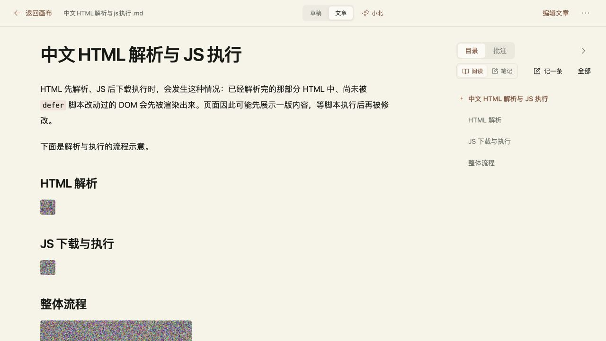

# BUG-D8985782 首次文章与草稿切换

2026-10-26，关联 VBP-118。用户补充：电脑，主要第一次慢。顾毅盛负责排查、实现与定向验收，任务 `7091aaa8-ab99-4a5d-9860-c7dcd195c699`。

## 原因与改动

草稿和整理文章已在画布客户端状态中，但同一笔记的版本及编辑按钮调用 `router.replace`。首次状态切换会请求 `/canvas?...&_rsc=...`，等待页面响应；后续路由缓存掩盖了等待。图片压缩无法消除这段等待。

同一笔记的草稿/文章、编辑/阅读以及小北打开同一文章，改用 `window.history.replaceState`。Next 已将原生 History API 与 `useSearchParams` 集成，现有 URL 派生逻辑直接更新界面。打开另一笔记和返回画布仍沿用原有导航。保存、正文、图片和批注实现不变，没有依赖或数据迁移。

依据：[Next 原生 History API](https://nextjs.org/docs/app/getting-started/linking-and-navigating#native-history-api)，并核对项目所安装 Next 16.3.3 的 App Router 实现。

## 验证

使用独立临时 SQLite、合成账号和优化构建。仅对画布 RSC 响应人为增加 1500ms，定位切换是否依赖服务器；这些耗时是受控实验，不能视为用户电脑或生产环境的速度承诺。

| 样例 | 旧版首次切换 | 修复版首次切换 |
| --- | --- | --- |
| 约 540KB、4 张内嵌图片的正文 | 1693ms，页面请求等待 1510ms | 123ms，同一笔记状态切换无页面请求 |
| 纯文字正文 | 未测旧版 | 81ms，无页面请求 |

`npm run build` 通过，BUILD_ID `umWtW13ocSg_C4LqnskrB`。真实浏览器确认：含图文章 4 张图片加载；两版批注隔离；编辑草稿后立即切到文章再切回，刷新后修改保留且文章未被覆盖；复制两版正文正确（导出保留既有节点元数据）；从画布打开文档后切换状态，浏览器后退返回画布，前进恢复最后文章 URL。代理记录在验收区间内没有带笔记参数的 RSC 请求。

DP 用例 `722aa8ee-03b2-495c-a565-2f28660a523f`，计划 `06d8fac0-f246-402d-8d44-522ada18d013`。证据：[构建](BUG-D8985782-document-switch/build.txt)、[浏览器](BUG-D8985782-document-switch/browser.json)、[网络](BUG-D8985782-document-switch/network.json)。

分支 `fix/BUG-D8985782-document-switch` 基于 dev `8c9c0949822c620eb7fb9b07a59651c8f22f8535`。回退该 PR 并重建即可恢复旧导航，无数据迁移。

只执行本次受影响流程的浏览器验收，未追加全站、移动端或真实模型回归。当前 Mac 不存在指定 Obsidian `D:/Obsidian/gysnote`，跳过该库写入；没有新增正式飞书文档或索引。

## dev 集成与生产准备

[PR #599](https://github.com/Gyschuaner/VibePolaris/pull/599) 合入 dev，提交 `068b941b501e52a99ae57d1a9e04250227275610`。该提交与已验收构建的所有非 docs 路径一致；最终 dev 真实浏览器重新打开含图文章，4 张图片正常。DP dev-local 批次 `bug-d8985782-dev-20261026`，任务完成，计划 1/1 通过。

当前 dev 与 main 有其他待发布内容及历史差异，直接合并的 #600 已关闭。本次发布分支 `release/BUG-D8985782-document-switch-production` 从 main `befd2513bf136b984e2b004b2932ebc938ac417e` 建立，挑入已合 dev 的 `70a6ab745d6046712fe6cda1d55cb651baa058d0`；相较 main 唯一运行代码差异为本次 CanvasWorkspace 修复。生产源提交 `e5f81718c45cd409ce70eccd0c384b80f176091f` 重新构建通过，BUILD_ID `k0ybWLTayQ4kfeE_fMSCv`，见 [生产构建](BUG-D8985782-document-switch/production-build.txt)。

发布授权沿用用户前述图片与切换性能修复上线要求。

## 生产实绩

[PR #601](https://github.com/Gyschuaner/VibePolaris/pull/601) 合入 main，实际部署提交 `2f082e26451a9977c48646f36bb945b0a8252945`，部署时间 2026-10-26 16:08:42（Asia/Shanghai）。与重新构建的源提交相比，所有非 docs 路径一致。以原生产镜像提供相同 Linux 依赖与支持文件，只替换已校验的 Next 构建；包、锁文件、静态资源和部署配置均未改变。

隔离容器启动及依赖预检通过。生产容器 healthy，7 项匿名 HTTP 检查全部符合预期：公开页面和 session 为 200，账号画布、笔记接口为 401。合成账号内约 540KB 的既有草稿首次切文章成功，4 张图片全部加载；切回草稿、编辑/阅读及刷新状态正确，控制台错误为 0。生产单次自动化观测为 624ms，包含工具开销、没有人为延迟，不作普遍速度承诺。没有修改该账号正文或调用模型。

发布目录 `/opt/vibepolaris/releases/20261026T080424Z-2f082e26`。上版为 `5d2b0c8661486758804fd01c6b1de7271f9f6f1d`；在线 SQLite 备份位于 `/opt/vibepolaris/backups/20261026T080424Z-from-5d2b0c86`，`quick_check=ok`，备份文件权限 600。使用 `sudo /opt/vibepolaris/releases/20261026T080424Z-2f082e26/rollback.sh` 可恢复上版镜像及 current 链接，保留实时数据卷；脚本权限 700，未实际执行回滚。原 `vibepolaris_xiaobei_data` 数据卷保留，补全计费仍为 false。

只清理本次发布的 3 项 source.local 构建缓存，释放约 472.2MB；未清理镜像、数据卷或备份，磁盘剩余约 1.7GiB。远端输入包和构建上下文已清理。

DP 生产批次 `bug-d8985782-production-20261026`（`16bf94a4-0662-4ea7-9fbf-f113a6b1d138`），用例 `d9692150-a907-42ea-940c-a24182d20a9f`，计划 `cb7ceb59-eb87-4505-84fe-1535a996c728` 完成、1/1 通过。BUG-D8985782 已关闭（v5），任务完成，VBP-118 保持已发布。

证据：[发布与备份](BUG-D8985782-document-switch/production-release.json)、[生产浏览器](BUG-D8985782-document-switch/production-browser.json)、[清理及权限](BUG-D8985782-document-switch/production-cleanup.json)。

