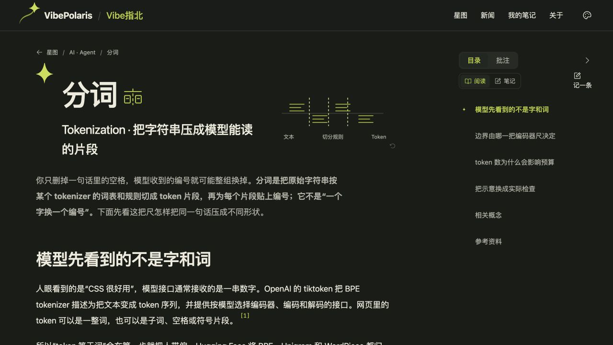

# BUG-E0160A08 图标系统生产发布

用户于2026-10-18明确授权“发布生产吧”。关联需求VBP-064，负责人顾毅盛。实现与373项逐条结论见[图标审阅记录](BUG-E0160A08-term-icon-review.md)。

## 发布版本

- [PR #474](https://github.com/Gyschuaner/VibePolaris/pull/474) 从dev合入main，生产提交 `e2977485e1f3ef9d4b37d27aca2a0c0752bc955b`，源码树 `ca6418dd5adb8b5aa1288a41bde7d96292f5d1bb`。保留已上线的新闻标签边界修复。
- 2026-10-18 10:19:20 UTC发布到 <https://vibe.chuansgu.top>。镜像 `vibepolaris:e2977485e1f3ef9d4b37d27aca2a0c0752bc955b`，Linux amd64；镜像标识 `sha256:7c55b83cf29891715f4bacbc1d24e8fc704c11df188532ca909689cacbbb6758`，revision标签与main一致。
- BuildID `HRjnIpeA33qzQiuKIJ73x`；发布目录 `/opt/vibepolaris/releases/20261018T101751Z-e2977485`。`current`已原子切换，`vibepolaris-web-1`为running/healthy。
- DP生产部署批次 `BUG-E0160A08-prod-20261018-e2977485`，对象 `2dd87a18-8854-48a9-8e97-7cb8cfffa61b`；生产冒烟计划 `2601b385-a6da-4514-870d-22c525849111`，用例 `e5a3a164-0d72-4517-8ee1-f0f0a550693f`。

## 构建与验证

在最终main源码上执行新闻预检查与标准Next Turbopack构建，exit 0，TypeScript和1184个静态页面生成成功。本机缺少npm，直接运行相同脚本入口；沿用已验证的干净子进程启动环境。

package、锁文件、Dockerfile及小北服务源码相对上一生产版本没有变化，复用已部署的Linux Node 22运行环境与依赖，替换完整`.next`、public和相同的package文件。没有传入密钥或本地对话库。通过rsync复用相同内容，服务器校验9580个文件；SHA256清单摘要为 `c85ecd10f74e836a36b7c28dd22b9277ff000e63df2225168be334924fc50dc5`。新容器内分词静态HTML的SHA256与本地构建一致：`6ff917f46e43cde5763941dcdb9d9c8888404b4eb5e9e680619179edd8548762`。

实际生产检查：

- HTTPS首页、分词、冒烟测试、Token词条均返回200；小北未授权请求返回401。
- 浏览器刷新后，分词从原滑杆变成文本切分轮廓；冒烟测试为关键检查灯；Token保留已确认的括定文本字形。三处标题实测44px。
- 分词在390px视口下，DOM实测viewport/pageWidth均390，标题图标38px；无横向溢出。桌面截图与上述尺寸测量分别留证。
- 浏览器捕获的console error为空。未发起付费模型请求，未重跑无关页面或用户识别实验；小北16px引用的线宽调整通过共享组件随该构建发布。



浏览器标题与视口数据见[生产核对数据](BUG-E0160A08-icons/production-browser.json)。

## 备份与回滚

切换前的生产镜像为 `vibepolaris:3ed7ed7b8df9c2c9c94f9e49af6efde1503c1301`，发布目录 `/opt/vibepolaris/releases/20261018T100142Z-3ed7ed7b`。两者均保留。

备份目录 `/opt/vibepolaris/backups/20261018T101751Z-from-3ed7ed7b` 保存旧Compose、运行版本、发布信息及SQLite在线备份，文件权限受限。数据库备份`quick_check=ok`，SHA256为 `60773f4d9544bcca32843d0972cc3c23ea6d89509ed7c8fb6d45924b21bc1875`；备份SHA256SUMS已校验。

容器仍挂载原 `vibepolaris_xiaobei_data` 到 `/app/.xiaobei`，没有替换生产数据或环境文件。回滚入口为服务器上的：

```sh
sudo /opt/vibepolaris/releases/20261018T101751Z-e2977485/rollback.sh
```

脚本使用备份Compose恢复旧镜像，健康通过后将`current`切回旧发布目录，继续保留现有数据卷，不覆盖发布后新增的对话和积分记录。切换脚本配置了失败自动回滚；本次检查通过，未执行回滚。

保留用户原有 `VBP-047-production.md` 未提交修改。本机不存在指定的Windows Obsidian库，部署事实保存在本记录与DP。
