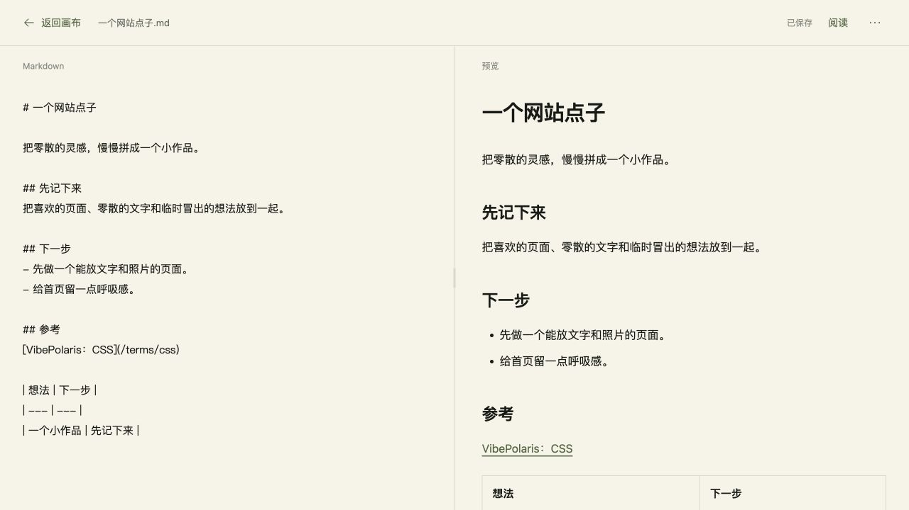
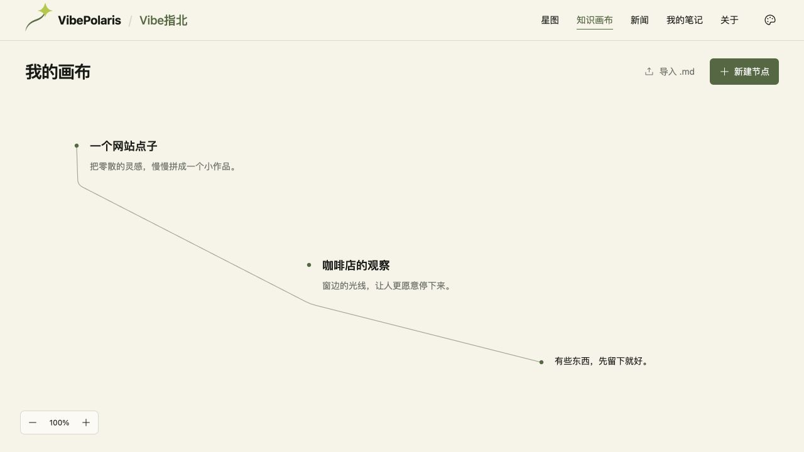

# VBP-095 / VBP-096 知识画布生产发布

用户于 2026-10-19 明确授权“完成好之后检查没问题了直接发布上线”。本次上线自由 Markdown 画布、可调分栏预览和 BUG-07337509 的连线文字避让。

## 版本与范围

- 开发实现 `197b02974c38c4acf8ee3456c197473994ec7f59` 经 [PR #478](https://github.com/Gyschuaner/VibePolaris/pull/478) 合入 dev `c50c86468388cc6f29b7cde425cf74b5bbdfa851`；本地 dev 构建及浏览器验证通过。
- [PR #479](https://github.com/Gyschuaner/VibePolaris/pull/479) 发布到 main `598a2a4c5458dd5aa89ff264db024419507e2fe1`。发布分支从已上线 main 选入 dev 已验收的 VBP-095 与 VBP-096 提交，画布源码与 dev 逐文件一致。VBP-094 文案清理继续保留在 dev。
- 发布分支执行标准新闻预检查与 Next production build，TypeScript 和 1185 页面成功；最终 main 源码树与该构建完全一致，树标识 `7be93adf811667491dae6cd7417c23095aab616a`。
- 2026-10-19 03:51:57 UTC（北京时间 11:51:57）切换生产 <https://vibe.chuansgu.top/canvas>。主机 `150.109.241.213`，使用现有 `co-agent-tencent-direct` SSH 配置；旧迁移主机未执行发布写操作。
- 镜像 `vibepolaris:598a2a4c5458dd5aa89ff264db024419507e2fe1`，Linux amd64；镜像标识 `sha256:a02254c10b39997d4f95cf1003c930cd721259e1182e8ce7541d0c3b6b75d514`，revision 标签匹配 main。BuildID `fNgmhzu4pDtY9o_uFGhIB`。
- 发布目录 `/opt/vibepolaris/releases/20261019T034806Z-598a2a4c`；`current` 已原子切换。部署标识 `VBP096-prod-20261019-598a2a4c`。

## 构建与实际验收

依赖、锁文件、Dockerfile、Compose 及小北服务源码与上一生产版本完全相同。复用已上线的 Linux amd64 Node 22 运行时和依赖，替换完整 `.next`、public 和相同 package 文件；不打包环境文件、密钥或本地对话库。9608 个文件在服务器逐项 SHA256 校验通过，清单摘要 `c7810bada539a345ad083aef5c3f21545d21082c9f9cb02d14e9a22f3cf86197`。新镜像先在无外部网络的独立容器内启动并确认 `/canvas` 200 与 BuildID，再切换正式服务。

- `vibepolaris-web-1` 为 healthy。HTTPS 首页和画布返回 200，未授权对话接口返回 401。
- 生产真实浏览器 1280×720：首次画布为零节点；新建任意 Markdown 后左右实时预览，表格和本站词条链接正常；分隔条拖动 50→59，双击恢复 50。阅读切换、刷新后正文保留。
- 三个手动测试节点可连接；拖动咖啡节点后 SVG 路径更新并连续绕开文字，未修改其他节点位置。真实 DOM 路径与截图留存。
- Markdown 复制、下载均与编辑原文逐字一致；重新导入下载文件从 3→4 节点，原三节点坐标保持。控制台 warn/error 为空。
- 验收后通过产品操作清理本次手动测试节点，刷新后回到零节点、零连线的空白画布。没有预置内容，也没有修改服务器上的用户画布数据；画布仍只保存于各自浏览器。
- 窄屏 390px 分栏、独立滚动、键盘分隔条、缩放与额外几何检查已在同一画布源码的 dev 版本通过，见 [本地验收](../design/VBP-096-canvas-refinements/README.md)。未增加无关整站回归、真实手机硬件或存储故障注入。





浏览器实测数据与样例清理结果见 `docs/design/VBP-096-canvas-refinements/production-browser.json`、`production-cleanup.json`。

## 备份与回滚

切换前保留旧镜像 `vibepolaris:e2977485e1f3ef9d4b37d27aca2a0c0752bc955b` 与旧目录 `/opt/vibepolaris/releases/20261018T101751Z-e2977485`。

备份 `/opt/vibepolaris/backups/20261019T034806Z-from-e2977485` 保存旧 Compose、权限受限的环境文件、运行版本事实和 SQLite 在线备份。数据库 `quick_check=ok`，SHA256 `e15b41964ac07e9ec50b1e327220e02aa2684f7c1f23651100f9b86d56ea46dc`；目录 700、文件 600。正式容器继续挂载原 `vibepolaris_xiaobei_data`，没有恢复或覆盖数据库。

服务器回滚入口：

```sh
sudo /opt/vibepolaris/releases/20261019T034806Z-598a2a4c/rollback.sh
```

脚本恢复旧镜像和旧 Compose，健康通过后切回旧 `current`，继续使用现有数据卷，保留上线后新增的对话和积分。新画布的浏览器数据库也不清除，重新发布后可继续读取。部署脚本保留在发布目录，切换失败会自动执行上述回滚；本次通过，未触发回滚。

用户 primary checkout 的 `docs/development/VBP-047-production.md` 未提交运维更新保持原样。本机没有指定的 Windows Obsidian 库；本次研发及发布事实保存在 Git 和 DP，未新建正式飞书文档。
