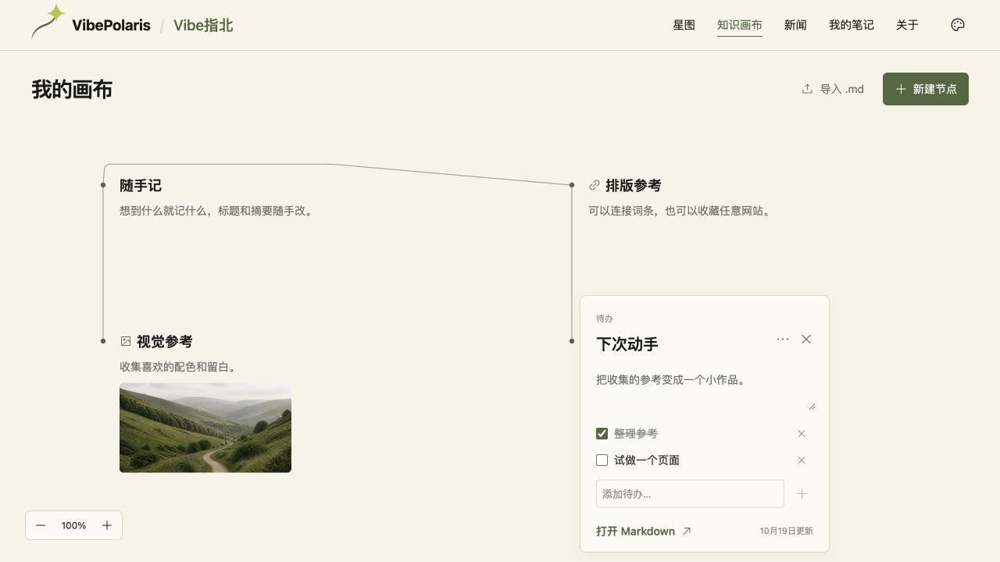
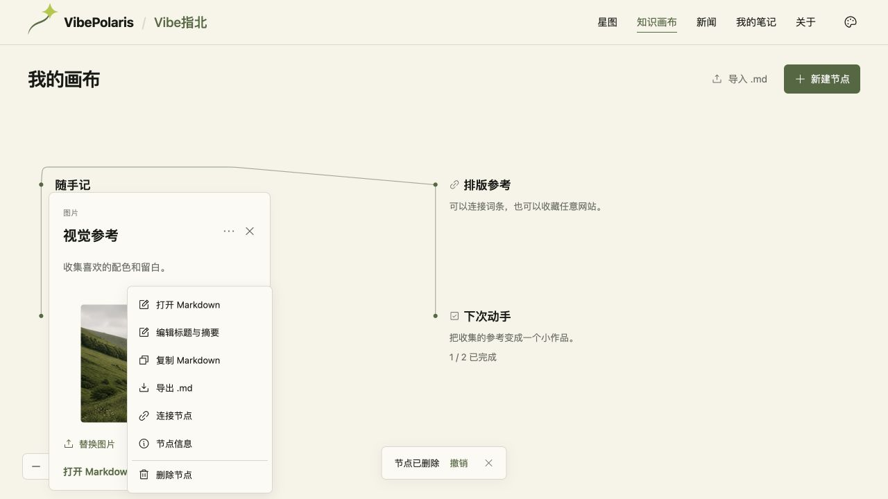

# VBP-097 画布右键管理与四种节点

用户在本轮明确选择笔记、链接、图片、待办，并沿用“完成检查后直接上线”的授权。

## 代码范围

- [PR #481](https://github.com/Gyschuaner/VibePolaris/pull/481)：实现 `24f71ae0185c043635c6264b67fc134b68812889` 合入 dev `5a812c4989ffa1f8f2bda2e8bf109a6fa08ffb5f`。右键创建/删除与共用节点菜单；标题摘要就地编辑；图片上传、网址、待办与 Markdown 互通。
- [PR #482](https://github.com/Gyschuaner/VibePolaris/pull/482)：从已上线 main 选入上述已验证实现，main `75d5bce631a4e84f5f37ee9824a03c907df2b72c`。2026-10-19 07:18:02 UTC 初次切换服务，健康 200/200/401。最终验收前发现 BUG-4267D97A，需求保持 testing，继续发布修正。
- [PR #483](https://github.com/Gyschuaner/VibePolaris/pull/483)：`1ad39f355bec5c34d46bc6b0b253f3829015a734` 修复撤销提示挡住菜单与高图片卡片越界，合入 dev `9ba5bd90ae99284d481f0313b412fa8427f525cf`。
- [PR #484](https://github.com/Gyschuaner/VibePolaris/pull/484)：选入同一修正，最终 main `fa83494761a84fdeb2220248fb4d95afcac65170`，源码树 `176515185203844d622e995cc18442d4ce62d72e` 与最终构建完全相同。画布源码与 dev 逐项一致，VBP-094 文案清理继续仅保留在 dev。
- 本轮增加可选 kind/title/summary。旧画布版本 1 兼容读取，保存升级版本 2；旧程序拒绝读取版本 2，防止丢弃新增信息。Markdown 注释携带节点元数据，本地图片内嵌，支持复制、导出、重新导入。位置和连线仍只保存在本浏览器，未新增账号或后端接口。

## 本地与 dev 验证

新闻预检查、生产构建（TypeScript、1185 页面）与 6 项 canvas 检查通过。两次代码集成均运行本机 dev 实例并用真实浏览器验证，DP 部署记录分别为 `local-dev-20261019-vbp097-5a812c49` 和 `local-dev-20261019-vbp097-9ba5bd90`，没有声称部署远端 dev。

受影响流程包括四种节点、就地编辑、Markdown 全屏分栏、图片复制/下载一致并重新导入、待办增删勾选、刷新、删除撤销、拖动连线、390px 菜单与卡片。BUG-51276764 图片取景裁切，以及 BUG-4267D97A 浮层遮挡均已有回归证据。最后清理本机测试节点后，原有 6 节点、3 连线保持不变。

详细证据见 [节点交互验收](../design/VBP-097-node-types/README.md)、`browser-facts.json` 和 `overlay-regression.json`。没有追加整站回归、真机触摸或本地存储耗尽注入。

## 生产部署

依赖、锁文件、Dockerfile、Compose、小北服务及脚本与此前运行时一致，复用现有 Linux amd64 Node 22 镜像及依赖，替换完整 `.next`（不含构建缓存）、public 和相同 package 文件。上传上下文不包含环境文件、密钥或本地对话数据库。服务器逐项校验 SHA256，独立无外部网络容器先验证 `/canvas` 与 BuildID，再备份、切换并检查健康；失败有自动回滚。

- 主机 `150.109.241.213`，SSH 使用现有 `co-agent-tencent-direct`；旧迁移主机未执行发布操作。
- 最终上线时间 `2026-10-19T07:32:49.776187+00:00`，地址 <https://vibe.chuansgu.top/canvas>，批次 `VBP097-prod-20261019-fa834947`。
- 镜像 `vibepolaris:fa83494761a84fdeb2220248fb4d95afcac65170`，镜像 ID `sha256:eec65c50210e3013d621c432311e968308069a1c6a2c970d7e6f8d995f491a5c`，BuildID `5TdFSOyjmDR3PtOSXHXLB`。
- 上下文 9612 文件 SHA256 校验通过，清单摘要 `e3dfd722cf36d1a95e09eac92b2455ed9e80a68abe3d583e0b4cd929077ab560`。
- 发布目录 `/opt/vibepolaris/releases/20261019T072539Z-fa834947`，`current` 已切换；服务 healthy，首页与画布 200，未授权对话接口 401。
- 备份 `/opt/vibepolaris/backups/20261019T072539Z-from-75d5bce6`：保留前一 Compose、权限受限环境文件和 SQLite 在线备份，quick_check=ok，数据库 SHA256 `e15b41964ac07e9ec50b1e327220e02aa2684f7c1f23651100f9b86d56ea46dc`。原数据卷 `vibepolaris_xiaobei_data` 继续使用，未恢复覆盖数据库。

## 线上实际验收

独立生产浏览器 1280×720，初始 0 节点、0 连线。真实右键创建四种节点；笔记全屏 Markdown 修改后卡片手动标题摘要不变；站内链接、图片上传和待办 1/2 勾选正常。四种节点形成 3 条连线。图片复制与下载同为 231495 字符，且与 dev 逐字一致；重新导入恢复图片类型、标题和摘要，刷新后 5 节点、3 边、两张图片 naturalWidth=905，待办勾选保留。

线上有撤销提示时菜单删除项中心仍命中自身，图片卡片底部 708.18 < 720（保留 12px）。删除图片后为 3 节点、2 边，撤销恢复 4、3；之后逐个清理本次测试节点，刷新回到 0、0。没有改动其他浏览器中的用户内容。浏览器 warn/error 为空，证据见 `production-browser.json`。





## 回滚

保留旧镜像 `vibepolaris:75d5bce631a4e84f5f37ee9824a03c907df2b72c`、旧目录 `/opt/vibepolaris/releases/20261019T071305Z-75d5bce6`，以及首发前的 598a2a4c 镜像和备份。

```sh
sudo /opt/vibepolaris/releases/20261019T072539Z-fa834947/rollback.sh
```

此入口回到前一个多类型节点版本 75d5bce6，继续使用现有数据卷，保留新内容；会恢复该版本已知的浮层问题。若需要整体回到画布首发前的 598a2a4c，可再运行 `/opt/vibepolaris/releases/20261019T071305Z-75d5bce6/rollback.sh`；旧程序会保留但拒绝读取浏览器版本 2 的画布，重新部署新版后可继续使用。两次上线都通过健康检查，未实际触发回滚。

本机没有指定的 Windows Obsidian 库，记录保存在 Git 和 DP。没有创建新的正式飞书文档。用户 primary checkout 中 `docs/development/VBP-047-production.md` 的未提交运维更新保持原样。
