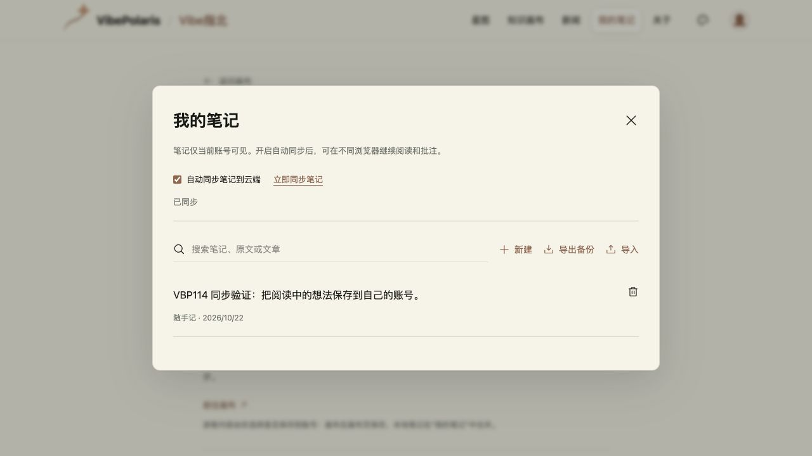
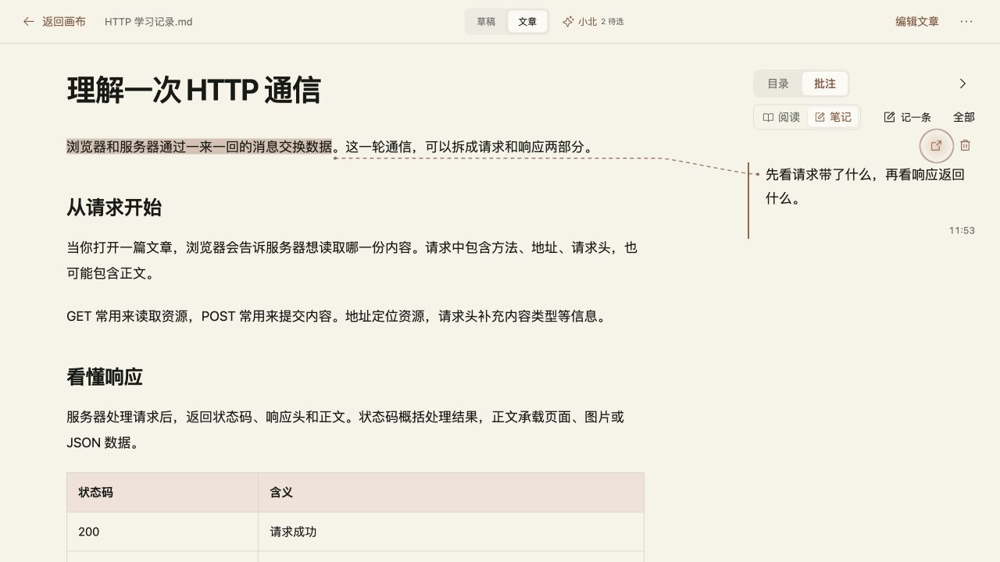

# VBP-114 阅读批注与账号笔记同步

关联 VBP-114，任务 d078c71c-d6e3-41f9-adb0-f2012b4e392e。沿用用户验证后上线授权。

## 实现与数据归属

画布 Markdown 阅读复用 ReadingNotes、目录侧栏、选文工具和原 NoteEditor。草稿与文章的批注分别写入节点 annotations.draft/article，跟随 useCanvas 的保存及同步。桌面旁注与原文连线，窄屏目录和批注进入底部面板；编辑界面保持双栏 Markdown。正文改写后无法匹配的摘录仍可在本文笔记中找回。

全站“我的笔记”按账号隔离。游客继续使用原 vibepolaris-reading-notes 数据库；账号缓存使用独立 vibepolaris-account-notes，退出后恢复游客库。登录只读取账号云端数据，游客笔记需明确点击合并，原件保留且重复内容去重。

账号笔记有独立的自动同步开关，默认关闭，设置页和笔记抽屉同步显示。修改停下3秒后上传，30分钟静默检查，另有手动同步。GET/PUT /api/account/notes 使用既有账号会话、owner header 和 same-origin 保护；SQLite按账号一行存储并用 revision 比较更新，拒绝旧版本覆盖。三方合并保留独立修改，冲突保留两份，删除不覆盖另一端同时进行的编辑；请求期间的新编辑重新合并。容量及格式错误均保留本地修改。

画布格式升级到5，防止旧客户端忽略并丢失 annotations；服务端拒绝旧格式覆盖，刷新页面即可使用新版。旧格式1–4可读入。JSON笔记备份支持画布来源，Markdown正文导出仍只导出正文。

## 本地验证

- npm run build 通过；三个受影响文件的定向测试共13项通过（账号权限、合并、画布批注往返、旧格式兼容和既有锚点/画布行为）。未运行整套check。
- 新增数据保存组件的定向ESLint通过。ReadingNotes原有布局effect及依赖规则告警未在本轮扩展重构。
- 真实浏览器：游客随手记、登录不自动合并、明确合并、自动同步、退出恢复原件；画布选文旁注、回原文、刷新、删除撤销、草稿/文章隔离、编辑态无批注UI、失配摘录找回。390px目录与批注面板可操作。
- 独立HTTP会话读到云端账号笔记和文章批注，匿名401、账号header不匹配403、跨站写入403。
- 仅使用合成账号和内容，未读取或修改用户私人画布。指定Obsidian D:/Obsidian/gysnote在本机不存在，跳过。

## 发布与回滚约束

本轮需要数据兼容发布。新增account_reading_notes表不删除既有数据；画布v5写入后不能直接切回只支持v4的旧镜像。需要回退界面时，应保留lib/canvas.ts、lib/reading-notes.ts、画布PUT版本检查和annotations合并兼容层，构建兼容修复版本再发布。保留当前数据卷，不回写旧数据库。

- 功能提交 `6de7349990b279561f67970be6d75ea7052f5778` 经 [PR557](https://github.com/Gyschuaner/VibePolaris/pull/557) 合入 dev `155be5aa6d33421b28a923f85b4943aa715d20d3`。项目未配置远端dev，本机3106运行与合并提交同树的优化构建、独立SQLite；另用localhost隔离存储域登录同账号，读回云端笔记和批注。见 [dev浏览器证据](VBP-114-reading-notes-sync/dev-browser.json)。
- 从main选择本轮改动，保留main已有导入错误提示，候选 `0528341013953555dedf97d4fc29eaead2133cfd` 独立构建通过。经 [PR558](https://github.com/Gyschuaner/VibePolaris/pull/558) 合入 main `bc75d7bd58ba3f4350d6d31349385c25cb4cdda4`；合并提交与构建候选Git tree一致。
- 北京时间2026-10-22 11:51上线。build `OJNFZPgTm5ns0QuiVi5wU`，发布目录 `/opt/vibepolaris/releases/20261022T034705Z-bc75d7bd`。逐文件及发布包SHA校验、无网络且无生产卷的独立容器启动通过，正式服务healthy。首页/画布/设置/session为200，匿名账号画布与笔记为401，原数据卷保留，补全扣费关闭。
- 在线SQLite备份 `/opt/vibepolaris/backups/20261022T034705Z-from-d674f208`，quick_check=ok。镜像ID、SHA、运行版本见 [发布事实](VBP-114-reading-notes-sync/production-release.json)。旧版恢复脚本 `rollback-before-v5.sh` 只用于首次切换失败且没有云端v5写入；脚本会拒绝已有v5数据时使用旧运行时。其v4放行/v5拒绝逻辑已用临时SQLite断言验证。浏览器已有v5草稿也应使用兼容修复版本；不清除本地数据。
- 正式站合成账号：独立同步开关、新建随手记手动同步、自动同步选择、选文旁注及回原文、刷新保留通过。独立HTTP会话读回1条笔记和1条文章批注，匿名401、owner不匹配403、跨站写403，控制台无error。见 [生产浏览器证据](VBP-114-reading-notes-sync/production-browser.json) 与 [API检查](VBP-114-reading-notes-sync/production-api.json)。测试账号已退出，临时标签关闭，恢复原阅读偏好；未操作用户私人画布或游客笔记。
- VBP-114 released，任务done。dev计划 `7d804ba2-8b7b-4c31-b024-44865f01aefb` 两项通过；production计划 `d24d0dec-a26d-4ab3-8e0b-aaec1bbc783e` 一项定向冒烟通过。未做真机测试，未等待30分钟整周期；间隔沿用已有常量，未调用模型或执行全站回归。

