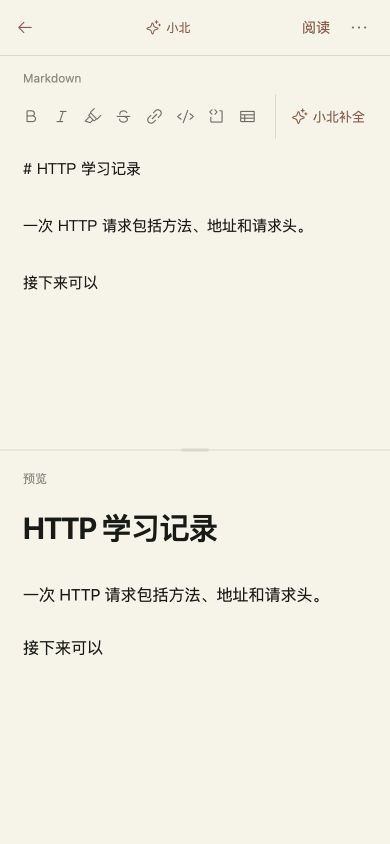

# VBP-115 手机和平板小北补全

关联 VBP-115，任务 ef4e1865-ffd8-4de8-b350-2f7e19e3571d。沿用用户验证后上线授权。

Markdown 编辑工具栏在视口不超过 1024px 或存在粗指针设备时显示“小北补全”。格式按钮独立横向滚动，补全操作固定在右侧，触摸区域至少 44px。点击复用原 generate；生成中禁用重复触发并可取消，建议可以接受或放弃。保留光标、后文、撤销及首次告知、账号激活、功能开关和计费策略。工具栏与正文共享焦点边界，切换控件不清除待接受建议。没有新增依赖、后端接口或数据格式。

本地优化构建通过；浏览器验证 820px 平板、390px 手机、桌面快捷键，覆盖首次告知、生成状态、光标中间插入、接受、取消、放弃和设置关闭。使用独立 SQLite、合成账号、本地 SSE 回复，断言请求只携带光标前文，控制台无 error；未调用真实模型。没有远端 dev，使用本机 3107 的同树优化构建完成集成复核，验收后停止。

[PR561](https://github.com/Gyschuaner/VibePolaris/pull/561) 合入 dev `45f2d3e4d96dc8730f610c80ca0a17c86bf69522`，与已构建 `042c193d589483d39b4f93b783654abe5b8c9d02` tree 一致。仅选择本轮三个前端文件进入生产，候选 `cb0841b1fdbe28ff02e0f2009ff6f32d2e7fe0cd` 独立构建通过。[PR562](https://github.com/Gyschuaner/VibePolaris/pull/562) 合入 main `b15ad0622203cef7f74f4af65f34f70458e96a7a`，与候选 tree 一致。

[dev 检查记录](VBP-115-mobile-completion/dev-browser.json)。尚未做真机软键盘/触屏输入测试；浏览器验证为尺寸适配及鼠标/键盘输入。指定 Obsidian `D:/Obsidian/gysnote` 本机不存在，跳过。

北京时间 2026-10-22 16:14 上线，build `MpnrGw0BFJ_Z-HY8bLT16`，运行提交 `b15ad0622203cef7f74f4af65f34f70458e96a7a`。发布包与逐文件 SHA 校验、无网络且无生产卷的启动预检通过。正式服务 healthy，首页/画布/设置/session 为 200，匿名账号画布与笔记为 401；数据卷 `vibepolaris_xiaobei_data` 保留，补全扣费关闭。

SQLite 在线备份 `/opt/vibepolaris/backups/20261022T081051Z-from-bc75d7bd`，quick_check=ok。回滚可执行 `sudo -n /opt/vibepolaris/releases/20261022T081051Z-b15ad062/rollback.sh`，切回支持画布 v5 的 `bc75d7bd` 镜像，保留当前数据卷，不还原旧数据库。镜像摘要、备份与时间见 [发布事实](VBP-115-mobile-completion/production-release.json)。

正式站使用独立合成账号验证 820px/390px 的按钮布局，点击补全正确显示未激活反馈，关闭反馈后正文不变，控制台无 error；未绑定邀请码、未调用真实模型，未接触用户私人笔记。测试账号已退出，临时标签关闭、视口恢复。见 [生产冒烟](VBP-115-mobile-completion/production-browser.json)。dev 计划 `ffa953cf-5006-4b90-80bf-b41da33ada82`，production 计划 `cf171911-90ba-4930-9266-f9cb556bda99`。

