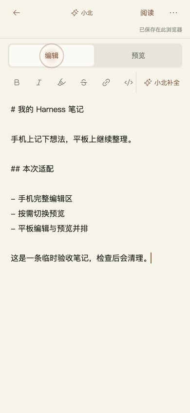

# VBP-116 导航、阅读与编辑的移动适配

DP 需求 VBP-116。用户授权完成后上线。设计、前端、验证与发布任务均由顾毅盛负责。

手机普通页面增加星图、画布、新闻、笔记底部导航；阅读页通过更多菜单访问全站入口。平板 768px 起保留文字导航。目录／批注使用可关闭的原生弹窗，支持焦点返回，教程目录纵向排列。手机编辑／预览切换保留输入框和光标，平板双栏限制最小宽度，格式按钮扩大触区，保存状态保持可见。编辑器响应可视视口高度变化，不新增依赖、模型调用、后端接口或数据格式。

[三类对照稿](../design/mobile-reading-editor/README.md)在实现前完成。原始工作区已有的 VBP-047 文档修改未动；在独立工作树中从 dev 开始。

本地 `npm run build` 通过。真实浏览器 390×844、360×640、600×800、820×1180、1360×900 验证：导航到设置，阅读目录定位与关闭焦点返回，CSS 目录单列不重叠，从面板进入随手记，Markdown 编辑／预览保持正文和光标，切换后原生撤销可用，平板分隔条键盘调整，窄屏返回单栏，保存反馈可见。390px 下输入区约 649px 高（此前约 301px），输入字号 16px；820px 双栏默认各 403.5px，Home 调整后较小一栏约 363px。小北补全按既有逻辑显示未激活反馈，没有调用真实模型。浏览器控制台未见 error。

实际触屏、中文软键盘和移动文件选择器尚未验证；尺寸模拟不等于真机验证。最小真机复核：打开一份独立笔记，调出中文键盘，输入后切换预览再回来，确认光标、保存、格式和补全按钮可达；旋转或分屏后正文保留。

DP Agent 的专用模型登录过期，本轮改用同一个官方 DP CLI 直接安全更新记录。飞书 CLI 本机未找到，正式飞书发布与文档索引未完成；这里保留需版本控制的设计与交付记录。指定 Obsidian `D:/Obsidian/gysnote` 不存在，跳过。

[PR #565](https://github.com/Gyschuaner/VibePolaris/pull/565) 合入 dev `dccee830c78b6c11f633ce98fe81b792b5b53099`，与已构建 `ca69cff8a7436890a284690aa58458db968ebd1d` tree 一致。无远端 dev，在本机 3134 运行同树优化构建 `v-uk0ssBzjl2rQsXtHkCu`；手机阅读、HTML/JS 目录、导航到新闻与笔记、编辑／预览保持状态、1024px 双栏均通过。见 [dev 浏览器事实](VBP-116-mobile-reading-editor/dev-browser.json) 和 [本地观察](VBP-116-mobile-reading-editor/local-checks.json)。

生产从 main 选择本轮已集成提交，未同时发布 dev 的其他待发布内容。候选 `ffd09775dce2adbf06fdaeccb292d46fc51517c9` 独立构建通过，[PR #566](https://github.com/Gyschuaner/VibePolaris/pull/566) 合入 main `93d16aa84098250d85a62e3c132a03019a790bef`，tree 与候选一致。北京时间 2026-10-22 23:42 上线，build `2of74JLE-NRrwI4KUzIj1`。

9185 个发布文件的 SHA256 校验、无网络无生产数据卷的启动预检通过。SQLite 在线备份 `/opt/vibepolaris/backups/20261022T153433Z-from-b15ad062`，quick_check=ok。运行服务 healthy；首页、画布、设置、session 为 200，匿名私有画布和笔记 API 为 401。保留 `vibepolaris_xiaobei_data` 数据卷和补全扣费关闭。完整信息见 [生产发布事实](VBP-116-mobile-reading-editor/production-release.json)。

回滚命令：`sudo -n /opt/vibepolaris/releases/20261022T153433Z-93d16aa8/rollback.sh`。切回前一版本 `b15ad0622203cef7f74f4af65f34f70458e96a7a` 镜像，继续使用当前数据库卷，不还原旧数据库。

正式站 390px 验证完整菜单、目录面板关闭后的焦点返回、编辑与预览保留正文；820px 双栏各 403.5px，未发现页面横向溢出或控制台 error。只新建、编辑并清理本轮临时游客笔记，原有游客笔记保留；没有登录、上传游客数据或调用模型。见 [生产浏览器事实](VBP-116-mobile-reading-editor/production-browser.json)。

DP dev 计划 `7e9528a4-f286-4577-8e43-db5541447d1d`；生产计划 `52d594ae-552e-4322-ac75-065e2f8427d3`。测试和部署状态按实际结果登记。

