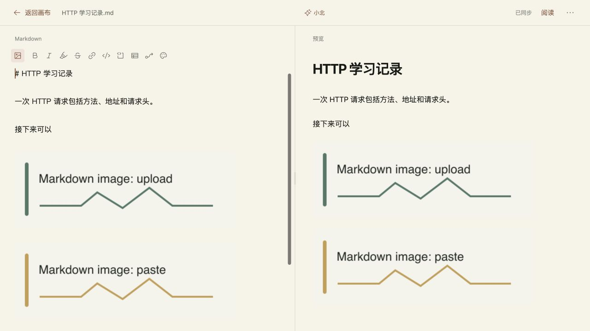

# VBP-118 Markdown 图片编辑

用户授权检查通过后直接上线，并补充要求编辑区直接显示图片、隐藏资源长链接。负责人顾毅盛，DP VBP-118；联动验收缺陷 BUG-2B73E90F。

编辑器提供固定的插入图片入口，支持多文件上传、粘贴截图和拖入文件。按原光标位置插入，普通文字选区保留，明确选中的图片可原位替换；每次插入、替换和删除均为独立撤销操作。图片读取期间暂时只读，异步结束前检查正文是否变化，失败不覆盖原文。

源码区采用 CodeMirror，文字继续编辑 Markdown，图片通过装饰块显示，源文件不改写成私有占位格式。复用项目已有 Markdown 解析器与安全地址校验，代码块、行内代码中的图片语法保持文字。图片可选中、替换、删除；稳定的图片装饰保留 DOM，修改其他文字不会重新创建同一图片。现有格式命令、小北灰字、触屏补全、编辑预览切换和展开动画焦点逻辑已接到新编辑器。

沿用现有 data URL 图片保存方式，无新服务、数据结构或数据库迁移。图片随正文保存在浏览器／账号画布，并可复制、导出和重新导入 Markdown。单张最多 5 MB，支持 PNG、JPEG、GIF、WebP、AVIF，验证实际可解码。插入后正文最多 10 MB，与既有 Markdown 导入限制一致。小北补全文本截取前过滤图片编码，保留周围文字；没有增加图像理解或改变积分策略。

BUG-2B73E90F：CodeMirror 的滚动处理器还接收布局合成事件，导致正在生成或刚显示的补全被取消。改为监听实际滚动元素的原生 scroll。合成模型浏览器回归已验证灰字持续显示、Tab 接受和撤销，测试请求不含图片编码。没有调用真实收费模型。

## 本地验证

`npm run build`、改动文件 ESLint 和 `git diff --check` 通过。聚焦自检 8/8 通过，覆盖插入顺序、转义名称、图片语法位置、安全地址、代码块不转图片、体积限制、补全上下文过滤及已有格式和渲染。

真实浏览器验证上传多图、粘贴截图，编辑区与预览原位显示、替换删除及撤销、加粗快捷键、合成补全接受和撤销。三种无效文件（SVG、损坏 PNG、6 MB PNG）均显示错误且原文不变。390×844 下插入按钮 44×44，无横向溢出，上传、粘贴、编辑预览切换正常。

复制和导出的 Markdown 内容一致，均含 5 张内嵌 PNG；阅读并刷新后 5 张图片均完整显示。同一测试账号从独立浏览器存储域读取云端笔记，3 张图片与文字仍在。仅操作独立合成账号及生成的图片，未接触用户笔记。

拖放处理通过浏览器测试页的 File／DataTransfer／drop 事件验证，编辑器和预览显示 dropped 图片，正文保留。浏览器工具的跨 iframe 鼠标拖动返回目标不可用，因此未声称完成 Finder 拖文件的实机验证。未做手机／平板真机软键盘和系统截图剪贴板验证；最小复核是在设备上粘贴截图或选相册图片，确认原位显示，再撤销、切换阅读并刷新。

本机指定的 Obsidian `D:/Obsidian/gysnote` 不存在，跳过。DP 专用 Agent 登录失效，使用同一官方 CLI 记录需求、任务、测试与发布。无飞书 CLI，本次维护代码相关的版本化记录及 DP 索引。

## 集成与发布

dev PR [#575](https://github.com/Gyschuaner/VibePolaris/pull/575) 合并为 `835337ad871ec88e4a6e734e50c4236f2a026be2`。同树优化构建在 3107 部署并通过定向浏览器验收：四张图片完整、补全接受与撤销正常，另一个浏览器存储域从账号云端读取四张图片。

生产候选从 main 单独切出，未包含其他 dev 功能。候选 `b15301828bf05b47cd9e44e8ad095f2afc50f2ab` 构建通过；PR [#576](https://github.com/Gyschuaner/VibePolaris/pull/576) 合并的 `1efe6a8f5d5b43a76b9c187f6046b895c24a5b5a` 与候选同树。2026-10-23 03:19:33 UTC 切换生产，BUILD_ID 为 `ZnjB_fK5zauN38RxroRJC`。

发布以不可变 `ad8cd024` 镜像提供原 Linux 依赖，锁文件已有依赖保持不变，只补入新增的 12 个纯 JavaScript 包。校验归档、文件清单、依赖和隔离启动后，在线备份 SQLite 并通过 quick_check，沿用 `vibepolaris_xiaobei_data` 卷，补全扣费继续关闭。主站、新闻、画布、设置与会话接口返回 200；未登录的私有画布及笔记接口返回 401。

构建导出阶段曾耗尽剩余磁盘。回收本次已复制完毕的构建输入，并确认无任何容器引用后，删除旧镜像 `3bec8041`、`02584f99`，最终可用空间 3.4 GB；当前镜像、回滚镜像、数据卷和其他服务均保留。后续同类发布前至少预留 6 GB，不能只按解压包三倍估算。

正式站合成账号上传和粘贴两张 PNG，编辑内、预览、阅读和阅读刷新均显示完整，重新编辑保留图片；独立 API 确认云端正文含两张内嵌图片及原文。截图见下。测试会话已退出，游客画布未更改。正式站隐藏页视口工具未能从 1280 改成 390，因此未将这次操作计作窄屏通过，窄屏结论沿用本地／dev 的证据。

发布目录 `/opt/vibepolaris/releases/20261023T031349Z-1efe6a8f`；备份 `/opt/vibepolaris/backups/20261023T031349Z-from-ad8cd024`。运行发布目录内的 `rollback.sh` 可回滚至 `ad8cd024490fb6f071a912bd34989569ada7a891`，保留当前数据卷，不覆盖发布后新增内容。数据库快照仅用于单独的数据恢复。

DP VBP-118 为 released，研发任务完成，BUG-2B73E90F 已关闭。dev 计划 `7b3d5980-e623-4580-81d4-f55750eabca9` 和生产桌面计划 `13e83da6-10f7-48eb-8260-a013a13de1fb` 均已完成，用例通过。实际构建、部署与校验事实保存在同目录 `release-checks.json`。
