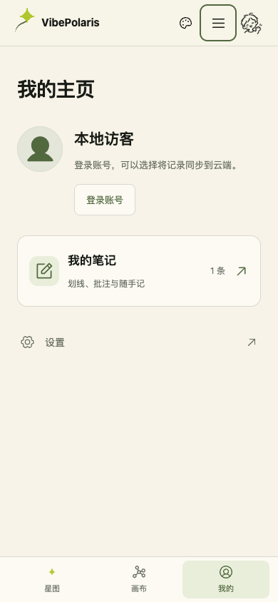

# VBP-119 板块开关与个人主页

2026-10-23，负责人顾毅盛。用户要求五个板块有独立开关，当前先隐藏新闻、关于，并将我的笔记放到用户主页。完成 dev 集成后，用户进一步明确授权直接上线，新闻和关于保持隐藏。

## 配置与入口

统一配置为 `content/site-modules.json`，服务端和客户端共用；修改后重新构建部署生效。使用版本化配置管理全站开放范围。

| 开关 | 板块 | 当前值 |
| --- | --- | --- |
| `graph` | 星图 | `true` |
| `canvas` | 知识画布 | `true` |
| `news` | 新闻 | `false` |
| `notes` | 我的笔记 | `true` |
| `about` | 关于 | `false` |

桌面主导航默认保留星图、知识画布。手机按实际开放数量均分底部入口，默认是星图、画布、我的；更多菜单与页脚同步过滤。新闻关闭时，列表和详情地址临时重定向，sitemap 和小北的新闻检索不再提供新闻链接。关于也隐藏入口并临时重定向。

关闭星图只关闭首页星图，现有概念词条和教程仍可阅读。关闭全站笔记时隐藏汇总面板及公开阅读页的批注入口，原数据保留；画布节点内的笔记属于画布，继续跟随画布独立保存。开关控制产品开放范围，不改变账号权限或数据格式。

回退目标依次选择已开放的星图、画布、新闻、关于；全部关闭时使用 `/me`，避免循环。个人主页和设置始终可访问。

## 个人主页

从头像进入 `/me`。主页集中展示身份、我的笔记和设置；游客也可进入、打开原来的本地笔记面板，并从主页登录。登录账号的头像菜单增加我的主页，保留设置。设置页可返回主页，退出登录也回到主页。

我的笔记复用原 NotesProvider，保留搜索、新建、删除撤销、导入导出及原有账号同步。没有迁移、合并、删除用户数据或新建笔记存储；游客与账号的原有隔离方式保持不变。

## 已执行验证

- `npm run build` 通过，Build ID 为 `8Iqogjo0gxdgXiIhWTWPq`。
- 一项聚焦自检通过，覆盖 32 种布尔组合的可用回退目标、全部关闭，以及笔记开关不改变首页选择。未运行全站测试。
- Google Chrome 真实浏览器：桌面从头像进入主页，游客新建笔记、刷新后保留；设置返回主页；合成账号创建笔记、经头像菜单再次打开、退出后原游客笔记仍在，未混入账号笔记。
- `/news`、一条既有新闻详情和 `/about` 均返回 307 到 `/`；站点地图不再包含新闻及关于。
- 390×844：星图／画布／我的之间跳转、主页笔记打开与关闭、更多菜单均正常。三个底部入口各 122×53px，页面宽度与滚动宽度均为 390px，无浏览器页面错误。
- 临时开发服务逐项实际切换五个开关，验证独立开放、隐藏和旧址回退；全部关闭时四个页面地址均到 `/me`，阅读正文仍可见。结束后恢复上表配置并停止临时开发服务。

证据：[浏览器结果](VBP-119-section-visibility/browser.json)、[开关切换结果](VBP-119-section-visibility/switches-browser.json)。DP 关联用例 `c39a2190-c013-4f80-a434-b35c9a9c4ffc`，计划 `f8c2c7bd-7210-4b11-a150-eed21aeb125f`。只操作本机独立合成账号及测试笔记，未调用收费模型。

## 集成与运行

从 `origin/dev` 的 `8fd49ad0` 创建 `feat/VBP-119-section-visibility`。PR [#579](https://github.com/Gyschuaner/VibePolaris/pull/579) 合入 dev 为 `bda2eb3ec93ebcb022e66c9ef5dc929517ea44df`，同树优化构建在 `http://localhost:3118/me` 完成 dev 集成验证；使用独立的本机测试数据库，不接入生产持久卷。

无数据迁移，回退 VBP-119 代码并重新构建即可恢复原入口；不需要恢复笔记数据。dev 集成使用本机服务，未部署远端 dev。

DP 专用 Agent 登录失效，已通过同一官方 CLI 完成业务记录。指定 Obsidian 库 `D:/Obsidian/gysnote` 在本机不存在，跳过。此次只维护与代码紧密相关的版本化研发记录及 DP 索引，没有新建飞书正式方案。

## 生产发布

用户授权后，从 main 的 `d4371f88` 单独挑入 VBP-119；候选 `43461404bf3564f55c8bdfc1fbe965b51c89aad1` 的 `npm run build` 通过。生产 PR [#580](https://github.com/Gyschuaner/VibePolaris/pull/580) 合并为 `f79775932065894e7cfc0d49110bb24cacb18511`，与候选同树，Build ID 为 `jOrlyU0AyDtjMPglLLb1q`。未把 dev 的其他差异带入生产。

2026-10-23 13:12:48 UTC（北京时间 21:12:48）切换生产。五个开关保持本记录上表取值，新闻、关于关闭。沿用上一版不可变镜像的 Linux 依赖，只替换经过校验的优化构建；依赖锁、静态资源、部署配置及运维辅助代码与上一版一致。归档校验、9,209 个文件的清单校验和无生产数据挂载的隔离启动均通过。发布前回收一天以上未使用的构建缓存，释放约 3.9 GB，达到至少 6 GB 的空间要求；当前镜像、回滚镜像和数据卷均保留，发布后可用空间约 5 GB。

SQLite 在线备份并通过 `quick_check`，沿用 `vibepolaris_xiaobei_data` 数据卷，无数据库迁移，补全扣费继续关闭。健康状态为 healthy，首页、画布、个人主页、设置和会话接口返回 200；未登录的私有画布接口返回 401。

正式站 Google Chrome 桌面和 390×844 浏览器验证通过：头像进入主页、游客笔记新建与刷新、设置返回、合成账号笔记保存及退出后恢复游客记录；手机星图／画布／我的跳转、笔记打开与更多菜单均正常。底部入口各 122×53px，页面及滚动宽度均为 390px，无页面错误。新闻列表、既有新闻详情与关于均返回 307 到 `/`，导航、更多菜单及 sitemap 均不包含关闭板块。仅操作独立测试浏览器与合成账号，未访问用户已有笔记，测试会话已退出，未调用收费模型。

生产定向用例 `fc5cad74-33d6-4378-a430-d0f414ae6d59`，计划 `d5b02125-d4db-4934-88cc-48b7c2bb508a`。实际证据：[生产浏览器结果](VBP-119-section-visibility/production-browser.json)、[生产发布事实](VBP-119-section-visibility/release-checks.json)。

发布目录 `/opt/vibepolaris/releases/20261023T130942Z-f7977593`；备份 `/opt/vibepolaris/backups/20261023T130942Z-from-1efe6a8f`。执行发布目录内的 `rollback.sh` 可恢复上一版 `vibepolaris:1efe6a8f5d5b43a76b9c187f6046b895c24a5b5a`，并保留当前持久卷及发布后新增记录。数据库快照只用于单独的数据恢复，不在应用回滚时覆盖线上数据库。

DP VBP-119 已为 `released`，研发与生产发布任务均完成；生产计划已完成且 1/1 通过。生产部署批次 `vbp119-production-f7977593`，精确提交、备份和入口见 DP 部署记录。
