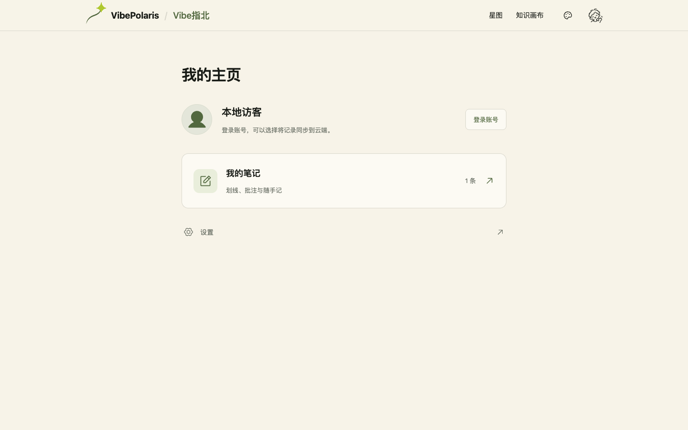

# VBP-119 板块开关与个人主页

2026-10-23，负责人顾毅盛。用户要求五个板块有独立开关，当前先隐藏新闻、关于，并将我的笔记放到用户主页。本次范围为实现和 dev 集成，未授权生产发布。

## 配置与入口

统一配置为 `content/site-modules.json`，服务端和客户端共用；修改后重新构建部署生效。使用版本化配置管理全站开放范围。

| 开关 | 板块 | 当前值 |
| --- | --- | --- |
| `graph` | 星图 | `true` |
| `canvas` | 知识画布 | `true` |
| `news` | 新闻 | `false` |
| `notes` | 我的笔记 | `true` |
| `about` | 关于 | `false` |

桌面主导航默认保留星图、知识画布。手机按实际开放数量均分底部入口，默认是星图、画布、我的；更多菜单与页脚同步过滤。新闻关闭时，列表和详情地址临时重定向，sitemap 和小北的新闻检索不再提供新闻链接。关于也隐藏入口并临时重定向。

关闭星图只关闭首页星图，现有概念词条和教程仍可阅读。关闭全站笔记时隐藏汇总面板及公开阅读页的批注入口，原数据保留；画布节点内的笔记属于画布，继续跟随画布独立保存。开关控制产品开放范围，不改变账号权限或数据格式。

回退目标依次选择已开放的星图、画布、新闻、关于；全部关闭时使用 `/me`，避免循环。个人主页和设置始终可访问。

## 个人主页

从头像进入 `/me`。主页集中展示身份、我的笔记和设置；游客也可进入、打开原来的本地笔记面板，并从主页登录。登录账号的头像菜单增加我的主页，保留设置。设置页可返回主页，退出登录也回到主页。

我的笔记复用原 NotesProvider，保留搜索、新建、删除撤销、导入导出及原有账号同步。没有迁移、合并、删除用户数据或新建笔记存储；游客与账号的原有隔离方式保持不变。

## 已执行验证

- `npm run build` 通过，Build ID 为 `8Iqogjo0gxdgXiIhWTWPq`。
- 一项聚焦自检通过，覆盖 32 种布尔组合的可用回退目标、全部关闭，以及笔记开关不改变首页选择。未运行全站测试。
- Google Chrome 真实浏览器：桌面从头像进入主页，游客新建笔记、刷新后保留；设置返回主页；合成账号创建笔记、经头像菜单再次打开、退出后原游客笔记仍在，未混入账号笔记。
- `/news`、一条既有新闻详情和 `/about` 均返回 307 到 `/`；站点地图不再包含新闻及关于。
- 390×844：星图／画布／我的之间跳转、主页笔记打开与关闭、更多菜单均正常。三个底部入口各 122×53px，页面宽度与滚动宽度均为 390px，无浏览器页面错误。
- 临时开发服务逐项实际切换五个开关，验证独立开放、隐藏和旧址回退；全部关闭时四个页面地址均到 `/me`，阅读正文仍可见。结束后恢复上表配置并停止临时开发服务。

证据：[浏览器结果](VBP-119-section-visibility/browser.json)、[开关切换结果](VBP-119-section-visibility/switches-browser.json)。DP 关联用例 `c39a2190-c013-4f80-a434-b35c9a9c4ffc`，计划 `f8c2c7bd-7210-4b11-a150-eed21aeb125f`。只操作本机独立合成账号及测试笔记，未调用收费模型。

## 集成与运行

从 `origin/dev` 的 `8fd49ad0` 创建 `feat/VBP-119-section-visibility`。优化构建预览在 `http://localhost:3118/me`；使用独立的本机测试数据库，不接入生产持久卷。Git 合并及本机 dev 部署的精确提交以 DP 部署记录为准。

无数据迁移，回退 VBP-119 代码并重新构建即可恢复原入口；不需要恢复笔记数据。未部署远端 dev 或生产，未合并 main。

DP 专用 Agent 登录失效，已通过同一官方 CLI 完成业务记录。指定 Obsidian 库 `D:/Obsidian/gysnote` 在本机不存在，跳过。此次只维护与代码紧密相关的版本化研发记录及 DP 索引，没有新建飞书正式方案。
