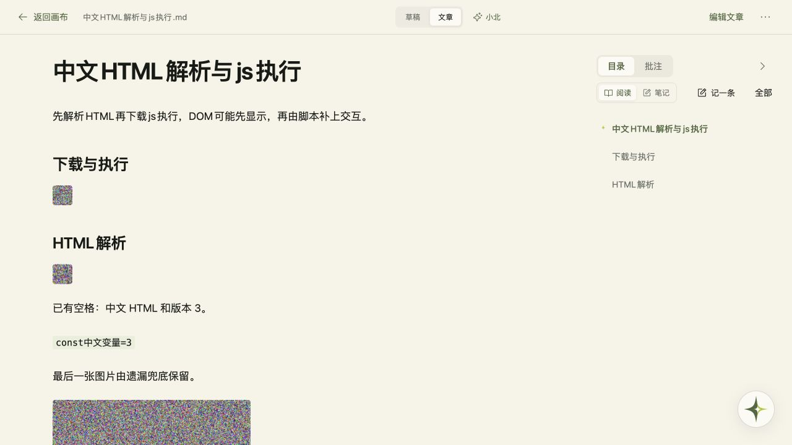
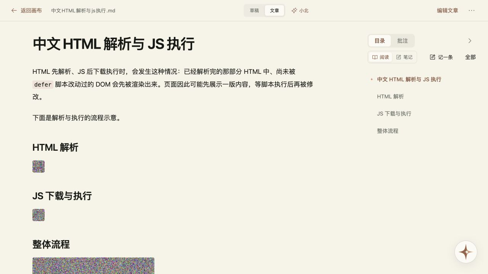

# VBP-123 文字留白与画布图片修复

2026-10-26。本轮包含 VBP-123、VBP-118 下的 BUG-452CB170（整理遗漏图片）及 BUG-51EA0B5F（含图 Markdown 切换卡顿）。总负责人及开发、测试负责人均为顾毅盛。开发阶段先交付 dev，随后用户明确授权三项一起上线。

## 实现

- 全局使用原生 `text-autospace: normal`，表单继承，中文与英文、数字之间由排版引擎留白；不插入实体空格，不改变原文、搜索或复制内容。代码、URL、邮箱、密码字段使用 `no-autospace`。兼容依据见 [MDN](https://developer.mozilla.org/en-US/docs/Web/CSS/Reference/Properties/text-autospace)；旧浏览器不支持时沿用原来的紧凑排版。
- 整理前提取安全的 Markdown 图片（含引用图片），以带 alt 的唯一短标记交给模型，本地保留原图地址和标题。完成后按章节还原，每个标记只还原一次；模型漏掉、改写标记或将图片放进代码围栏时，将未显示的原图补到末尾，确保图片不丢。草稿保持不变，已有文章仍走候选采用流程。模型依据图片位置、alt 和上下文组织文章，不把图片编码发送给模型识图。
- 图片上传、粘贴、拖入共用读取入口。200 KB 以上 PNG/JPEG 尝试转质量 0.92 的 WebP，宽度最多 2560px；仅文件更小时采用，失败或浏览器不支持时保留原图。GIF、WebP、AVIF、检测到动画控制块的 PNG 保留原格式；已有笔记不自动改写。文件逐张读取和解码，最终仍受 5 MB 单图与 10 MB 文档限制。
- `MarkdownDocument` 使用 `memo`，相同正文不因目录、保存等局部状态重复解析。编辑图片和预览、阅读图片使用异步解码及懒加载。

## 实际验证

`npm run build` 成功；`tests/markdown-editor.test.mjs` 与 `tests/canvas-ai.test.mjs` 共 9 项通过。聚焦自检覆盖大体积内嵌图、引用图、原图标题、重排、重复、遗漏与代码围栏，未追加全仓回归。变更文件 ESLint 和 `git diff --check` 无错误。

本机优化构建运行于 `http://vbp123.localhost:3133`，使用独立临时 SQLite 和合成邀请码、本地 SSE 模型。真实浏览器执行导入草稿、编辑、输入与撤销、插入图片、切换阅读、复制 Markdown、整理成文、刷新和切回草稿：

- 标题、简介、小北输入框、Markdown 编辑、预览和阅读继承留白；代码使用 `no-autospace`。输入和撤销正常，复制原文未增加实体空格。
- 同一张 307678 字节 PNG 的 data URL 从 410262 字符变为 121515 字符 WebP，减少约 70.4%，保持 320×320；新增图和原有三张 PNG 都可显示，lazy/async 生效。
- 540723 字节含图草稿对应模型请求 2065 字节，无 base64，含 4 个短标记和 alt。合成模型重排、重复一张并遗漏两张后，文章保留 4 张原图且各一次，图片地址、标题逐项比对相同。刷新后图片完整，切回并复制草稿与整理前字节完全一致。

证据：[构建](VBP-123-text-and-images/build.txt)、[聚焦测试](VBP-123-text-and-images/focused-tests.txt)、[浏览器结果](VBP-123-text-and-images/browser.json)。

dev 阶段使用合成模型，生产阶段已执行一次真实小北整理（见下文）。没有执行跨设备性能基准；上述体积减少来自合成 PNG 样本，不代表所有图片都有相同比例。旧文档的大图仍保持原数据，正文复用和异步加载会减少重复开销；需要缩小既有图片时可重新插入。

## 交付与记录

分支 `feat/VBP-123-text-autospace` 从 `dev` 的 `b925ae572a1131411591ca148f808af6716e86f5` 建立。原工作区的新闻分支和未提交文件保持不动。PR、最终合并提交和 dev-local 部署批次以 DP 为准；部署批次使用 `vbp123-images-dev-20261026`，不涉及数据库迁移。

DP 定向计划：VBP-123 `978801f5-e846-460a-ab9c-11e5688bf252`；VBP-118 `a5dd73db-3aaa-4566-a9f3-521dd495970b`。结果仅记录实际运行的构建、聚焦自检和上述浏览器流程。

回退本轮 PR 的合并提交并重建即可恢复旧行为；新增 WebP 是标准 Markdown 图片，回退后仍可读取。dev-local 数据仅为独立临时合成数据，不覆盖个人或生产数据。

## 生产发布

用户随后明确授权三项一起上线。生产基线为 `ee74c1bccf2f687ce286bb95ddcfa6bcad90661d`，从 dev 选择 `17434089fa105e28e2b2b14864f69c2a353a6340` 建立 `release/VBP-123-text-images-production`，只包含上述三项及验证记录。生产候选重新执行 `npm run build` 成功，BUILD_ID 为 `RvOA6hYKCl1Syq9RYaCcC`；构建日志见 [production-build.txt](VBP-123-text-and-images/production-build.txt)。

沿用现有 Linux 运行镜像的依赖，仅更新 `.next`；锁文件、公开资源、Compose 和账本运行脚本与基线相同。发布前清理了两条属于既有 VibePolaris 构建的临时源缓存，共 891.9 MB；没有删除镜像、数据卷或备份，服务器可用空间恢复到 6.1 GiB。

生产切换前保留当前镜像和 Compose，使用 SQLite 在线备份并验证 `quick_check`。先在无网络、无生产数据卷的临时容器验证启动，再切换同名服务；健康检查失败时运行发布目录的 `rollback.sh` 恢复旧服务，保留发布后新增的数据。最终 main 提交、生产批次、备份路径及正式站冒烟结果以 DP 和本目录后续发布记录为准。

DP Agent 委派运行因上游 Codex 凭证失效中止，已按 CLI Skill 回退到官方 CLI 维护记录；网络通过临时本机 SSH TCP 转发连接相同 DP 来源，保留 TLS 证书校验，不修改持久配置。此 Mac 不存在指定的 `D:/Obsidian/gysnote`，跳过 Obsidian 写入。没有新增正式飞书文档，故无新增飞书索引。

### 生产实绩（2026-10-26）

[PR #591](https://github.com/Gyschuaner/VibePolaris/pull/591) 已合入 main，应用运行提交 `3fb15282cf50144f93ee271b2dde9e9c95c2662a`，北京时间 11:16 完成切换。生产目录 `/opt/vibepolaris/releases/20261026T031343Z-3fb15282`；镜像 ID、构建校验与 HTTP 结果见 [production-release.json](VBP-123-text-and-images/production-release.json)。容器 healthy；首页、画布、设置、激活和会话接口 200；未登录画布与笔记接口 401。数据卷 `vibepolaris_xiaobei_data` 保留，无数据迁移。

正式站在既有专用 QA 账号下新建空白账号画布，仅导入合成草稿；游客画布未导入或修改。真实浏览器验证输入、撤销、复制、插入大图、编辑/预览/阅读、真实小北整理、刷新和切回草稿。新增 PNG 转 WebP 的 data URL 从 410262 缩为 121515 字符，显示尺寸保持 320×320；原有 3 张 PNG 与新图均正常。真实模型输出文章 4/4 图片，源、alt、title 逐项一致且无内部标记；刷新后仍有 4 图，切回草稿的 540723 字节与整理前完全一致。证据：[浏览器](VBP-123-text-and-images/production-browser.json)、[图片完整性](VBP-123-text-and-images/production-integrity.json)。限时测试邀请码已禁用，测试账号已退出。

备份 `/opt/vibepolaris/backups/20261026T031343Z-from-ee74c1bc`，SQLite 在线备份 quick_check=ok。回滚脚本 `/opt/vibepolaris/releases/20261026T031343Z-3fb15282/rollback.sh` 恢复上一版 `ee74c1bccf2f687ce286bb95ddcfa6bcad90661d` 的镜像、Compose 和 current，保留发布后新增数据；仅记录方法，未执行回滚。

DP 生产批次 `vbp123-images-production-20261026`，环境 production；VBP-123 已发布，BUG-452CB170 / BUG-51EA0B5F 已关闭。生产计划 `b7db489f-3129-471e-b2d2-8d56a19e0cbe` 与 `244e0652-530f-43ea-87bc-6dd044f87171` 各 1/1 通过，生产任务已完成。未执行跨设备性能基准，不将单张合成样本体积变化泛化为所有图片；旧文档不自动批量压缩。
